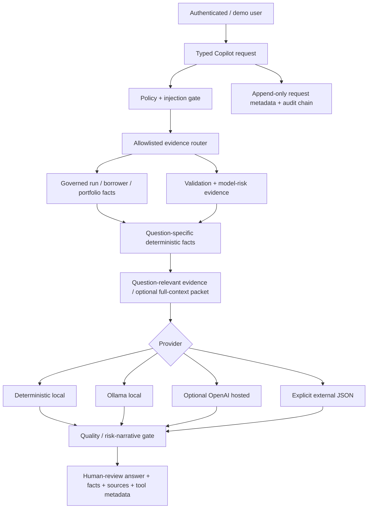

# GenAI Copilot architecture

The Copilot is a **grounded narrative layer**, not a second risk engine.

## Separation of responsibilities

`credit_platform/copilot.py` is isolated from the PD/LGD/EAD/ECL, staging and governance engines. The Copilot may **explain and synthesize** governed evidence, but it does not calculate or replace authoritative risk outputs.

Exact analytical questions—such as customer/industry rankings, concentrations and explicit borrower adverse indicators—are routed through deterministic governed calculations for the final numerical answer. Open-ended interpretation can use the richer provider context.

There is no model-generated SQL execution path.

## Evidence scope

Depending on the selected use case, the provider context can include portfolio totals and aggregations, EAD/ECL shares, mean PD/LGD, concentration evidence, Watchlist/SICR/EWS/stage reasons, top borrowers/facilities, complete admitted borrower features, facility decision traces, scenario PDs, LGD/EAD/ECL, collateral/guarantee evidence, and frozen model-risk research findings.

The packet is structured and business-readable; it is not an unrestricted raw database dump.

## Providers

- **deterministic** — default local provider; no LLM or API dependency.
- **ollama** — local conversational provider; current implementation version `ollama-v6-relevant-context`.
- **openai** — optional hosted Responses API provider; current adapter version `responses-v4-full-context`.
- **external-json** — explicit HTTPS adapter requiring opt-in.
- **auto** — chooses a configured hosted key, then configured Ollama, otherwise deterministic.

Provider failure falls back to deterministic governed evidence.

## Controls and audit

The current prompt version is `credit-risk-copilot-11`. Responses retain separate answer, facts, sources and tool-call metadata. Prompt-injection/refusal patterns, evidence checks and narrative quality gates reject known unsafe or misleading formulations, including treating Stage 1 as intrinsically “high risk” or treating a research/model-use gate as a ban on new credit.

Request metadata records actor/role, use case, hashes, provider/version, prompt version, status, tools and sources. Raw prompt/answer text is not used as an authoritative credit decision record. Human review remains required.

Current authorization is a shared reference scope; institution-specific row-level entitlements, IAM, privacy/vendor controls and production security qualification remain external deployment requirements.
