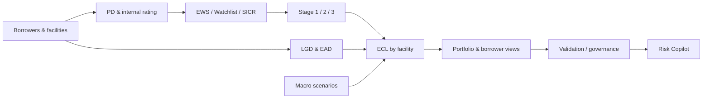

# Credit Risk Analytics | End-to-End Research Platform

**From borrower information to governed credit-risk decisions—PD, ratings, early warning, IFRS 9-style staging, LGD, EAD, ECL, portfolio monitoring and model validation.**

A working Python/Streamlit demonstration built with **synthetic data**, a reproducible risk pipeline, documented challenger experiments, and an **optional local Ollama Risk Copilot**. Built for learning, research, independent challenge and professional demonstration—not live lending decisions.

**[Run it](#run-the-demo) · [What it does](#what-you-can-explore) · [Validation results](#reproducibility-and-validation) · [Research findings](#what-the-research-found) · [Full documentation](#documentation)**

## Run the demo

Install **[Git](https://git-scm.com/downloads)** and **[Python 3.12](https://www.python.org/downloads/)**. Then paste the appropriate commands into your terminal.

**Windows PowerShell**
```powershell
git clone https://github.com/adel3amr/Credit-Risk-Analytics.git
cd Credit-Risk-Analytics
py -3.12 run_demo.py
```

**macOS / Linux**
```bash
git clone https://github.com/adel3amr/Credit-Risk-Analytics.git
cd Credit-Risk-Analytics
python3.12 run_demo.py
```

**Open [http://localhost:8510](http://localhost:8510)** and select a demo role. The first run creates an isolated `.venv`, installs pinned dependencies, rebuilds the synthetic V5 reference outputs and models, and initializes the local SQLite database. Subsequent runs **after the setup completes** reuse those artifacts when build inputs have not changed.

**Optional conversational AI—free and local:**

1. Install **[Ollama](https://ollama.com/download)** and run `ollama pull llama3.2`. Keep the Ollama app/service running.
2. Start the same project with **`py -3.12 run_demo.py --ollama`** on Windows or **`python3.12 run_demo.py --ollama`** on macOS/Linux.
3. In **Risk Copilot**, ask for a portfolio or borrower explanation. Open-ended questions receive **question-relevant governed context**, not the entire raw portfolio. Exact analytical questions are calculated by the deterministic engine. If Ollama cannot respond, the interface **clearly labels** the verified deterministic fallback.

No paid service, OpenAI key, Docker, or separate database server is needed for the local demo. For step-by-step installation, troubleshooting, existing-checkout setup and verification, see **[RUN_INSTRUCTIONS.md](RUN_INSTRUCTIONS.md)**.

## What you can explore

| Area | In the demonstration |
|---|---|
| **Portfolio Cockpit** | Borrower/facility counts, stage mix, EAD/ECL, rating and industry breakdowns, exposure concentrations and monitoring signals |
| **Borrower Credit File** | Borrower risk drivers, PD, rating, EWS, Watchlist/SICR, facility terms, collateral/guarantees, stage reasons and ECL traces |
| **Risk Management** | Local role/override and macro-scenario **demonstration** workflows; institutional controls remain a separate qualification task |
| **Model Validation** | PD discrimination and calibration, LGD error/bias and tail analysis, challenger findings and blocked promotion decisions |
| **Risk Copilot** | Portfolio and borrower interpretation based on governed evidence, with deterministic numeric analytics and optional local Ollama narration |

### How the research components connect



The core credit-risk calculations are deterministic; the LLM does **not** score borrowers, modify models, approve credit or determine ECL.

## Reproducibility and validation

On the **24 October 2026** reviewed main-line build, GitHub Actions verified:

| Check | Outcome |
|---|---|
| Automated Python suite | **256 passed, 1 upstream warning** |
| Frozen V5 release checks | **30/30 passed** |
| Reference platform shadow | **5,172 facilities**, **zero stage mismatches** |
| Reference EAD | **2,091,914,075.83** synthetic monetary units |
| Reference ECL | **45,265,972.04** synthetic monetary units |
| Audit integrity | **VERIFIED** |
| PostgreSQL 16 / Alembic migrations and WN-1 persistence | **PASS** |
| Headless Streamlit startup / Docker image build | **PASS** |

**[View live CI results](https://github.com/adel3amr/Credit-Risk-Analytics/actions)** · **[Reproduce the evidence](REPRODUCIBILITY.md)** · **[Read the validation map](PUBLICATION_READINESS.md)**

The local demo runs on SQLite. The CI also exercises a PostgreSQL deployment path, but does not establish production security, real-bank model approval or live Ollama response quality.

## What the research found

The synthetic-bank research contains **65,000 borrowers, 113,012 facilities and 2.34 million monthly conduct observations**. A separate WN-1 study contains **8,000 dated workout facilities**, recoveries, guarantees and collateral events. The interactive governed reference shadow uses a **3,000-borrower / 5,172-facility** population; those populations should not be confused.

The LGD work is deliberately not presented as a sequence of successful models: severe-loss tail bias, guarantee-feature availability and population-transfer limitations persist. Later R2, economic LGD and WN-1 challengers are preserved with their adverse results; **no unsupported challenger is promoted**. The **institutional bank-use gate remains BLOCKED**.

Read the **[model inventory](MODEL_INVENTORY.md)**, **[independent validation evidence](FINAL_INDEPENDENT_VALIDATION_REPORT.md)** and **[limitations](LIMITATIONS.md)** for the underlying decisions and unresolved findings.

## Important boundaries

- All borrowers, exposures and outcomes are **synthetic**; EAD/ECL figures above are **synthetic monetary units**, not assumed EUR.
- PD, ECL and staging methods are research implementations with documented assumptions, **not certified IFRS 9 production estimates**.
- The Streamlit dashboard includes frozen V5-derived views and a separately governed Copilot run view. Its local role/override examples are **not production IAM or institutional maker/checker authorization**.
- Local Ollama can interpret provided evidence; generated text still requires professional review. An exact-value query may be answered deterministically instead.
- Passing software tests and publication readiness **do not** equal validated deployment for real credit decisions.

## Documentation

**Start here:** [Run guide](RUN_INSTRUCTIONS.md) · [Full research overview](PROJECT_RESEARCH_OVERVIEW.md) · [Reproducibility](REPRODUCIBILITY.md) · [Publication status](PUBLICATION_READINESS.md)

**Technical:** [Architecture](TARGET_ARCHITECTURE.md) · [Data dictionary](DATA_DICTIONARY.md) · [API](API_DOCUMENTATION.md) · [Model feature contracts](MODEL_FEATURE_CONTRACTS.md) · [Copilot](GENAI_COPILOT_GUIDE.md)

**Research:** [Model inventory](MODEL_INVENTORY.md) · [Independent validation](FINAL_INDEPENDENT_VALIDATION_REPORT.md) · [LGD findings](lgd_research/LGD_FINDINGS_REGISTER.md) · [WN-1 workout results](workout_vnext/FINDINGS.md) · [Security/research limits](LIMITATIONS.md)

The historical branches and locked results are intentionally retained. Source files, manifests and rejected experiment outputs remain reviewable.

---

**Purpose:** an independently inspectable demonstration of credit-risk analytics, model-risk governance and AI-assisted interpretation built on synthetic evidence.
